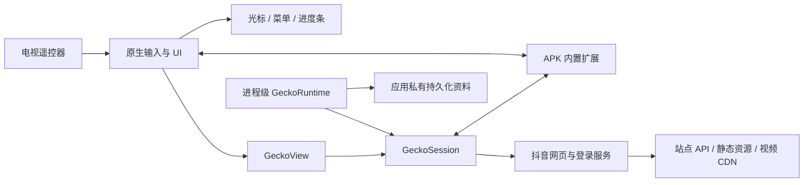
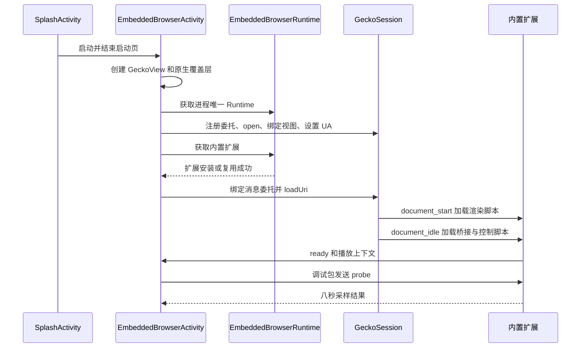

# 架构说明

## 文档定位与状态

本文记录 1.0.19 的实际实现，不是全新架构提案。当前版本仍有全新卸载重装后无法进入可用首页的问题，文档中的模块实现与构建通过不代表用户流程验收完成。最新状态见[项目总结](PROJECT_SUMMARY.md)和[诊断记录](电视流畅性诊断与内置内核验证.md)。

## 目标与系统边界

应用运行在 Android 11 及以上电视上，提供遥控器输入、浏览器容器、播放控制和诊断能力。内容、账号登录校验、视频资源和站点业务由抖音网页提供；应用没有独立内容后端，也不替代站点账号系统。

默认浏览器随 APK 发布，避免依赖电视上较旧的系统 WebView。原生交互界面独立绘制，但网页点击、站点播放器和资源请求仍会受到网页主线程、网络和服务端状态影响。

图中的模块是逻辑边界，不表示每个节点都是独立进程。Gecko 的内容、GPU 和媒体子进程由内核创建，数量不由本应用固定。

## 分层与模块职责

| 层 | 模块 | 职责与边界 |
| --- | --- | --- |
| Android 入口 | `SplashActivity` | 隐藏系统栏，立即进入内置浏览器，不固定延迟两秒 |
| 原生编排 | `EmbeddedBrowserActivity` | 视图和会话生命周期、委托、按键路由、消息、返回与日志 |
| 原生展示 | `BrowserPointerView`、`BrowserPlaybackOverlay` | 光标、点击反馈、播放时间和进度条 |
| 交互状态 | `BrowserControlModeState`、`BrowserPointerMotion` | 模式快照、移动速度和短按精度 |
| 浏览器运行时 | `EmbeddedBrowserRuntime` | 复用 GeckoRuntime 和成功安装的扩展，创建时保持同一配置 |
| 身份适配 | `BrowserIdentity` | 管理已验证的 Android 平板兼容 UA，区分兼容标记与实际内核 |
| 页面控制 | `native-bridge.js`、`remote-controls.js` | 固定命令协议、播放器操作、弹窗返回和性能采样 |
| 页面上下文 | `playback-context.js` | 观察播放及登录弹层，向原生发送状态快照 |
| 页面渲染 | `card-rendering.js`、`tv.css` | 屏外渲染和全屏样式适配 |

[旧 MainActivity](app/src/main/java/com/douyin/tv/MainActivity.kt) 与旧焦点脚本仍在仓库中，但默认启动链路不经过它们，当前新内核 manifest 不加载 `focus-engine.js`。保留代码不能作为旧路径仍被持续验收的证明。

## 生命周期与资源所有权

| 资源 | 所有者 | 创建、复用和释放 |
| --- | --- | --- |
| GeckoRuntime | 进程级 `EmbeddedBrowserRuntime` | 主线程首次创建，后续 Activity 复用；随进程结束释放 |
| WebExtension | 同上 | 只缓存成功安装结果，新的会话仍需绑定消息委托 |
| GeckoSession | 当前 Activity | 创建、打开并绑定 GeckoView；Activity 销毁时关闭 |
| GeckoView 和原生覆盖层 | 当前 Activity | 随视图生命周期释放 |
| Native messaging Port | 当前文档及会话 | 新导航或断开后置空，不向新页面重放旧按键 |
| 浏览器资料 | Gecko 持久化 profile | 普通会话复用；卸载或清应用数据会删除 |
| 采样结果文件 | 应用私有 cache | 调试包写入最新一份结果，不能用旧文件代替本次采样 |

`onPause` 停止光标移动并将会话设为 inactive，`onResume` 恢复 active；`onDestroy` 取消 Toast、断开 port 并关闭 session。不能把 Activity 关闭、Runtime 复用和 profile 持久化当作同一种生命周期。

## 启动链路

顺序图表达应用控制顺序，不承诺网络、DOM 就绪和首帧绘制之间有相同的耗时或完成顺序。原生进度、扩展 ready、网页导航完成、首页业务内容可用是不同状态；目前尚缺少完整的“首页已可用”判定和对应恢复机制。

调试包在进程冷启动时用 `installBuiltIn` 安装 APK 内资源；正式包用 `ensureBuiltIn` 检查扩展版本。修改扩展后要同步维护 [manifest 版本](app/src/main/assets/browser-extension/manifest.json)，不能只更改应用版本。

## 两条交互通路

### 原生指针通路

方向键由 `dispatchKeyEvent` 接收，原生显示帧驱动光标移动；确认键投递真实鼠标按下和抬起。悬停最多每 80 ms 通知网页一次。光标绘制不等待网页脚本，但网页命中和点击处理仍由浏览器执行。

### 页面语义通路

播放模式方向键、返回和媒体操作由 native messaging port 发送固定命令。扩展选择可见视频或站点控件，执行操作并回报结果。原生根据结果处理历史回退、模式恢复、进度条和提示。消息契约见[技术设计](技术设计.md)。

## 模式与返回策略

播放上下文来自原生 full screen 或页面视频弹层。首次进入保存原模式，重复通知不覆盖快照；退出时恢复原模式，光标坐标不重置。播放器内用户主动切换模式不改写进入前快照。

返回依次考虑登录弹窗、全屏或播放弹层、网页历史和首页退出。只有确认主页面后才使用连续两次退出；网页尚未确认弹层状态时保留网页校验。原生全屏退出与页面弹层关闭是不同动作，不保证仅退出浏览器 full screen 就已回到列表。

## 线程、性能和持久化

Android 视图与状态在主线程管理，Gecko 自身执行网络、脚本、合成与媒体任务。Native messaging 是异步边界，命令带序号及发送时间，不能假设按键发送即已执行。

当前 Runtime 配置的显示密度为 1.35、DPI 为 216；页面 CSS 尺寸还受内核布局影响，应以实际 viewport / DPR 为准。不要通过 CSS 全页缩放修正原生指针坐标。

屏外渲染减少列表绘制工作，但不会移除站点脚本，也不保证降低账号初始化和服务端等待。静态页、启动、滚动和播放必须独立测量。缓存由 Gecko 持久化资料及服务端缓存语义管理，不接管站点响应为永久离线副本。

## 连接边界与当前风险

内置扩展只匹配 `https://www.douyin.com/*` 和 `https://douyin.com/*` 的顶层文档；原生接入还检查 session、顶层标志及 `douyin.com` 主域边界。其他域名不会因名称包含 douyin 字符串就被接受。

这些检查限制的是消息桥接，不是所有导航请求的统一域名白名单。站点使用 http / https 新窗口时，当前实现改为原会话加载，其他新窗口请求不创建新会话。

当前风险包括：站点 DOM 选择器改版、登录状态差异、全新资料的初始化、首帧遮罩与实际内容状态不同步，以及重负载网页的命令排队。已有实现不能替代这些风险的实机验证。

## 代码与配套文档

- [原生浏览器入口](app/src/main/java/com/douyin/tv/EmbeddedBrowserActivity.kt)
- [运行时和扩展管理](app/src/main/java/com/douyin/tv/utils/EmbeddedBrowserRuntime.kt)
- [扩展入口](app/src/main/assets/browser-extension/manifest.json)
- [技术设计](技术设计.md)
- [编译与排障](GUIDE.md)
- [验收矩阵](PROJECT_SUMMARY.md)
